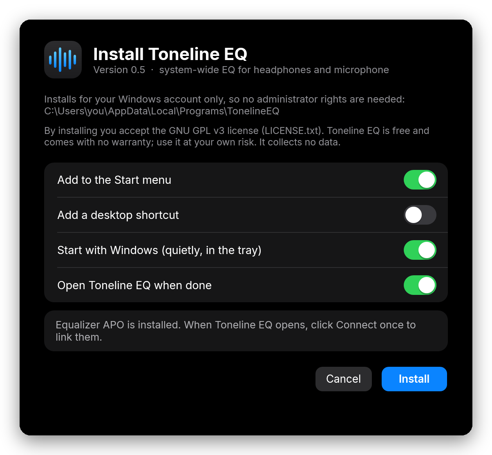
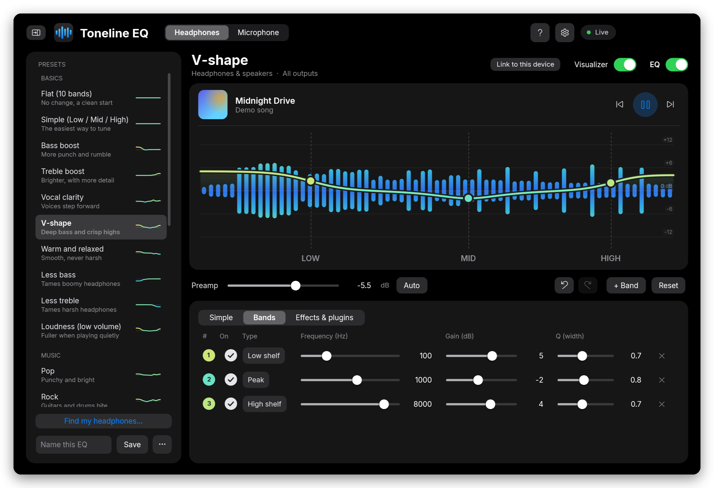

# Installing Toneline EQ

This takes about 10 minutes, including one Windows restart. No administrator rights are needed for Toneline EQ itself.

**You need:** Windows 10 or 11. Everything else is free and covered below.

- [Step 1: Install Equalizer APO](#step-1-install-equalizer-apo)
- [Step 2: Download Toneline EQ](#step-2-download-toneline-eq)
- [Step 3: Run the installer](#step-3-run-the-installer)
- [Step 4: Connect on first launch](#step-4-connect-on-first-launch)
- [Step 5: Make it sound good](#step-5-make-it-sound-good)
- [Updating](#updating) · [Uninstalling](#uninstalling) · [Troubleshooting](#troubleshooting)

> [!WARNING]
> **Turn your volume down before you start.** EQ boosts make sound louder, and the first preset you try may be louder than you expect.

---

## Step 1: Install Equalizer APO

Toneline EQ is the app you tune in. **Equalizer APO** is a free, open-source audio engine that applies the EQ inside Windows. Toneline EQ needs it.

1. Download Equalizer APO from its official page: **https://sourceforge.net/projects/equalizerapo/**
2. Run the installer and click through it.
3. At the end, the **Configurator** opens. This is the important part:
   - On the **Playback devices** tab, tick every device you listen on: headphones, USB DAC or dongle, speakers, headsets.
   - On the **Capture devices** tab, tick your **microphone** if you want to use the Microphone EQ.
   - Click **OK**.
4. **Restart Windows.** Equalizer APO only starts working after a restart.

> [!TIP]
> Only ticked devices get EQ. If you plug in new headphones later, open the Configurator again (Start menu → Equalizer APO → Configurator, or **Settings → Files and Windows → Equalizer APO Configurator** in Toneline EQ), tick the new device and restart.

## Step 2: Download Toneline EQ

1. On Toneline EQ's GitHub page, click the green **Code** button, then **Download ZIP**.
   (If the page has a **Releases** section on the right, you can download the zip from the latest release instead.)
2. Open your **Downloads** folder, right-click the zip and choose **Extract All…**, then **Extract**.

> [!IMPORTANT]
> Extract the zip first. Running the installer from inside the zip doesn't work, because Windows only unpacks that one file and the rest of the app is missing.

## Step 3: Run the installer

1. In the extracted folder, double-click **`Install Toneline EQ.cmd`**.
2. Windows may show a blue **"Windows protected your PC"** box. That's because Toneline EQ isn't code-signed (signing costs money every year). Click **More info**, then **Run anyway**.
3. A black window appears for a few seconds while Toneline EQ is built on your PC with the C# compiler that's built into Windows. Nothing extra is downloaded.
4. The installer opens. Choose what you want and click **Install**:

  

| Option | What it does |
|---|---|
| Add to the Start menu | Puts Toneline EQ in your Start menu. |
| Add a desktop shortcut | Puts an icon on your desktop. |
| Start with Windows | Starts Toneline EQ quietly in the tray when you log in. Your EQ works even when it's off, because Equalizer APO applies it; this just keeps per-device presets and the shortcuts running. |
| Open Toneline EQ when done | Opens the app right after installing. |

Toneline EQ installs for your Windows account only, in `%LOCALAPPDATA%\Programs\TonelineEQ`. You can delete the downloaded folder afterwards.

**Why a `.cmd` file instead of an `.exe`?** Unsigned `.exe` files from the internet get blocked or flagged a lot. Building on your own PC from the source code means you can read every line of what you run, and nothing is hidden.

## Step 4: Connect on first launch

The first time Toneline EQ opens, a banner at the top says *"Equalizer APO isn't reading Toneline EQ yet."*

1. Click **Connect**. Toneline EQ backs up your current Equalizer APO settings (`config.txt`) and points Equalizer APO at Toneline EQ.
2. The pill at the top right turns green and says **Live**. That means your EQ is applied.

If the banner says *"Windows blocked Toneline EQ from saving…"*, click **Restart as administrator** once. After connecting, Toneline EQ runs normally again.

## Step 5: Make it sound good

  

- **Pick a preset:** open the presets list with the button at the top left. Each preset shows a tiny preview of its curve.
- **Correct your headphones:** click **Find my headphones…**, search for your model, and click **Load correction**. This uses measurements from the AutoEQ project.
- **Keep it simple:** the **Simple** tab has just three sliders (Low, Mid and High) plus Quick picks.
- **Fine-tune:** drag the dots on the graph. Scroll over a dot to make it wider or narrower, double-click the graph to add a band, and press Delete to remove one.
- **Compare:** flip the **EQ** switch off and on to hear the difference.
- **One preset per device:** click **Link to this device** and that preset loads by itself whenever that device becomes your Windows default.
- **Microphone:** switch to **Microphone** at the top, pick a voice preset, and press **Test my mic** to hear 5 seconds of yourself with the EQ applied.

> [!TIP]
> Keep the **Preamp** negative, or press **Auto**, so loud boosts don't distort. The built-in presets already come with a safe preamp.

The **?** button at the top opens a short guide that explains bass, mids and treble, and how to set up your mic.

---

## Updating

Download the new version, extract it, and run **`Install Toneline EQ.cmd`** again. The installer says **Update**. Your presets, settings and device links are kept.

Coming from **EasyEQ** (Toneline EQ's old name)? Install Toneline EQ the same way. It removes EasyEQ and brings over your presets, settings, colors and device links. Old `EasyEQ:` share codes keep working.

## Uninstalling

Open **Windows Settings → Apps → Installed apps**, find **Toneline EQ**, and click **Uninstall**. You can choose to:

- **Put back your Equalizer APO settings** from before Toneline EQ (or just turn Toneline EQ's EQ off).
- **Keep your presets and settings** in case you reinstall later.

Equalizer APO stays installed. Remove it separately in **Settings → Apps** if you don't need it anymore.

---

## Troubleshooting

<b>I don't hear any difference</b>

1. Check that the pill at the top right says **Live**. If it says *Saved, not connected*, click **Connect** in the banner.
2. Make sure the **EQ** switch is on.
3. The device you're listening on must be ticked in the Equalizer APO **Configurator**, followed by a restart. If it isn't, Toneline EQ shows a red warning under the preset name with a **Fix in Configurator** button.
4. Some sound drivers need a different Equalizer APO mode. In the Configurator, click the device, tick **Troubleshooting options (only use in case of problems)**, pick a different install mode from the dropdown, click OK and restart. If one mode doesn't help, try another.

<b>The microphone EQ does nothing</b>

Equalizer APO only processes microphones you enable. Open the Configurator, go to the **Capture devices** tab, tick your mic, click OK and restart Windows. You won't hear mic EQ on yourself while talking; press **Test my mic** to hear it.

<b>Bluetooth headphones only work sometimes</b>

Bluetooth headphones can show up in Windows as two devices: a stereo one for music and a hands-free (headset) one used during calls. If you see two, tick **both** in the Equalizer APO Configurator and restart.

<b>Everything got quieter</b>

That's the preamp working as intended. When a preset boosts some frequencies, the preamp lowers the overall level so nothing distorts. Turn up your Windows volume a little instead of raising the preamp.

<b>The installer window says "Build failed" or can't find the compiler</b>

Toneline EQ needs the .NET Framework 4, which is built into Windows 10 and 11. If it's missing or broken, run Windows Update, then try again. If the build still fails, open an issue on GitHub and paste the error messages from the black window.

<b>A keyboard shortcut doesn't work</b>

Another app is probably using the same shortcut. Toneline EQ lists the ones it couldn't get under **Settings → General**. The shortcuts are:

| Shortcut | Does |
|---|---|
| Ctrl+Alt+E | Headphone EQ on / off |
| Ctrl+Alt+M | Microphone EQ on / off |
| Ctrl+Alt+Page Down | Next headphone preset |
| Ctrl+Alt+Page Up | Previous headphone preset |

<b>Something else went wrong</b>

Look for `%APPDATA%\TonelineEQ\error.log` (paste that path into the File Explorer address bar). Open an issue on GitHub with your Windows version, what you did, what happened, and the log. Read the log first; it's plain text.

---

[← Back to the Toneline EQ home page](README.md)
