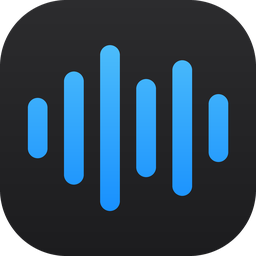
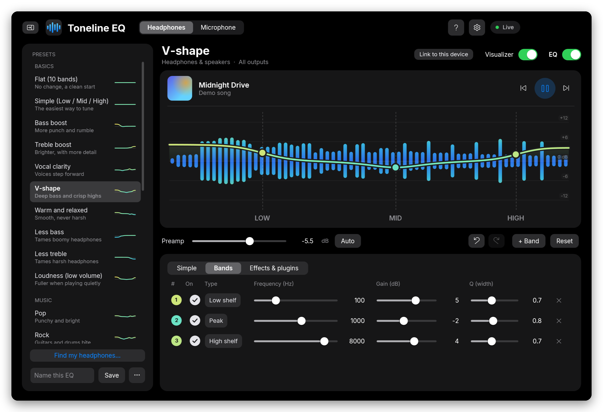
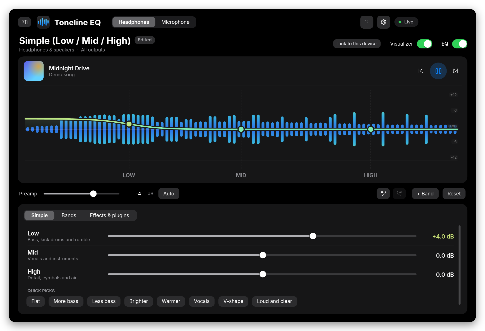
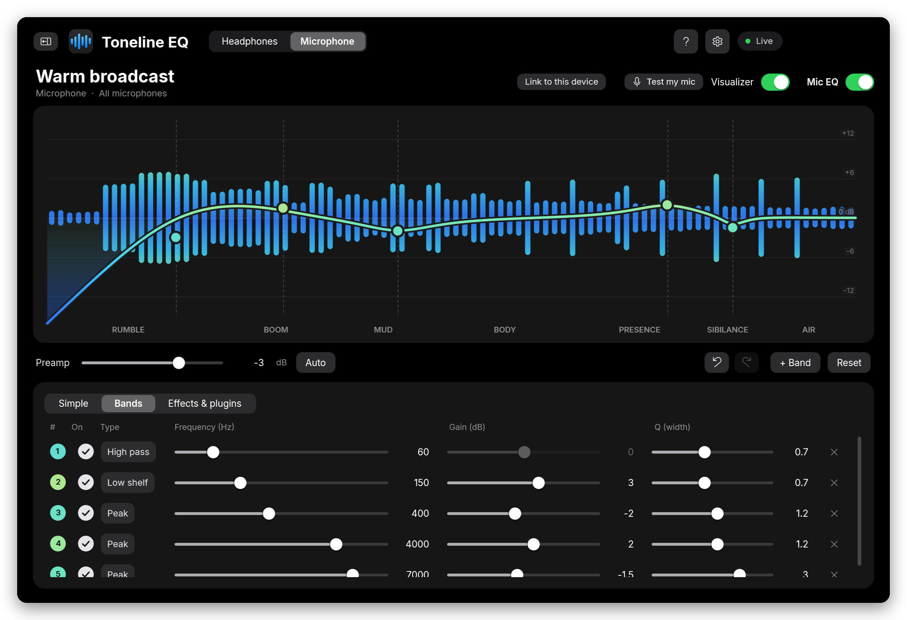
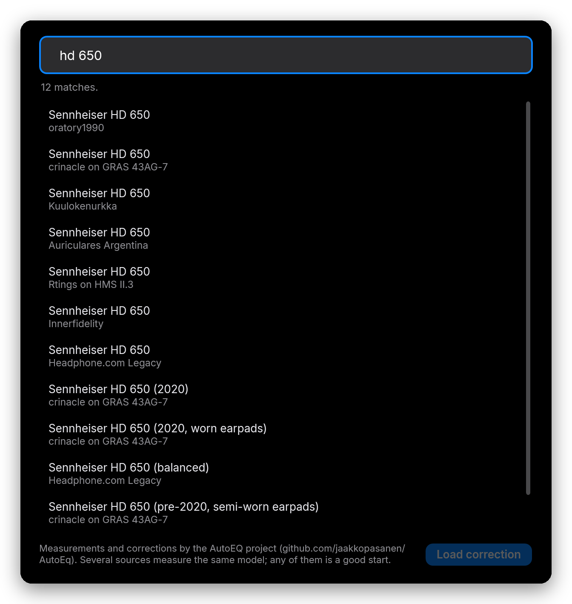
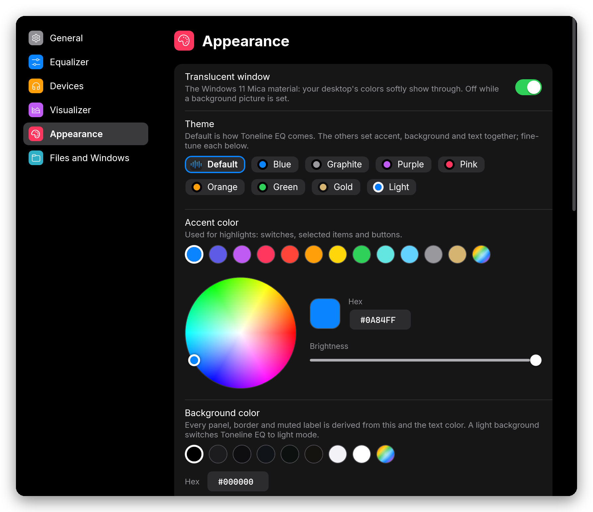
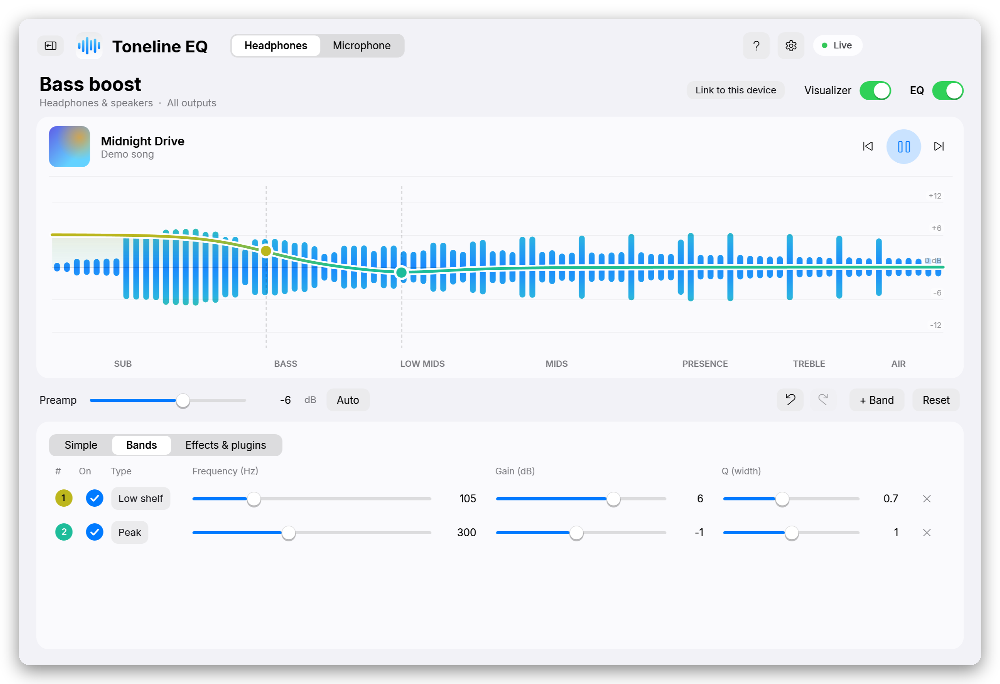

  

<h1 align="center">Toneline EQ</h1>

  <b>A free, good-looking equalizer for everything you hear and say on Windows.</b> 
  EQ for your headphones and your microphone in one small app. Works in every game, browser, Discord and OBS.

  <a href="INSTALL.md"><b>Install guide</b></a> ·
  <a href="#features">Features</a> ·
  <a href="#keyboard-shortcuts">Shortcuts</a> ·
  <a href="#faq">FAQ</a> ·
  <a href="PRIVACY.txt">Privacy</a> ·
  <a href="LICENSE.txt">License</a>

  
  
  
  

  

## Why Toneline EQ

- 🎧 **Better sound in one click.** 40+ presets, or find your exact headphone model and load a measured correction.
- 🎙️ **Sound better to others.** A separate EQ for your mic, with voice presets, fixes for hum and boom, and a 5-second "Test my mic".
- 🪶 **Stays out of your way.** Lives in the tray, uses very little memory, and has shortcuts that work inside games.
- 🔒 **Yours.** Free and open source, no account, no ads, no tracking.

## Get started

1. Install the free [**Equalizer APO**](https://sourceforge.net/projects/equalizerapo/) audio engine, tick your devices, and restart Windows.
2. Download this page (**Code → Download ZIP**), extract it, and double-click **`Install Toneline EQ.cmd`**.
3. Open Toneline EQ, click **Connect**, and pick a preset.

👉 **New to this? Follow the [step-by-step install guide](INSTALL.md).** It has pictures and fixes for common problems.

> [!NOTE]
> Toneline EQ is the app you tune in. Equalizer APO is the engine that applies the EQ inside Windows, so you need both. Toneline EQ connects to it for you.

## Features

<table>
  <tr>
    <td width="50%" valign="top">
       
      <b>Simple mode.</b> Just three sliders, Low, Mid and High, plus one-click Quick picks.
    </td>
    <td width="50%" valign="top">
       
      <b>Microphone EQ.</b> Voice presets, fixes for hum, boom and harsh "s" sounds, and Test my mic.
    </td>
  </tr>
  <tr>
    <td width="50%" valign="top">
       
      <b>Find my headphones.</b> Search thousands of measured headphones from AutoEQ and load a correction.
    </td>
    <td width="50%" valign="top">
       
      <b>Make it yours.</b> Themes and a color wheel for the accent, background, text, glow and visualizer colors.
    </td>
  </tr>
  <tr>
    <td colspan="2" align="center">
       
      <b>Light and dark.</b> Pick a theme, or follow your own colors.
    </td>
  </tr>
</table>

**Everything it can do:**

- **Two equalizers:** Headphones (what you hear) and Microphone (how you sound).
- **Interactive graph:** drag the dots to shape the sound. Scroll over a dot to change its width (Q), double-click to add a band, press Delete to remove one, and use Ctrl+Z / Ctrl+Y to undo and redo.
- **40+ ready-made presets:** basics, music styles, games and movies, speakers, and for the mic: voice styles, fixes and mic types. Each one shows a tiny preview of its curve.
- **Per-device presets:** link a preset to a device and it loads by itself whenever that device becomes the Windows default.
- **Share codes:** copy a preset as a short `Toneline:…` code. Anyone can paste it to load your EQ, even from inside a chat message.
- **Live visualizer** that colors itself by loudness.
- **Now Playing:** shows the current song from Spotify, a browser or any player, with play, pause and skip.
- **Effects & plugins:** gain, balance, mono, channel swap, impulse responses (convolution), VST2 plugins and custom Equalizer APO commands.
- **Smooth and native:** Windows 11 Mica translucency, the Inter font, spring animations and smooth scrolling.
- **A built-in guide** that explains bass, mids and treble in plain words.

## Keyboard shortcuts

These work anywhere, even in full-screen games.

| Shortcut | Does |
|---|---|
| Ctrl+Alt+E | Headphone EQ on / off |
| Ctrl+Alt+M | Microphone EQ on / off |
| Ctrl+Alt+Page Down | Next headphone preset |
| Ctrl+Alt+Page Up | Previous headphone preset |

Inside the app: Ctrl+Z / Ctrl+Y undo and redo, the arrow keys nudge the selected band (Shift for small steps), Delete removes it, and Ctrl+, opens Settings. Tab reaches every control.

## FAQ

<b>Is it really free?</b>

Yes. Toneline EQ is free and open source under the GNU GPL v3. There are no ads, no accounts and no paid version.

<b>Does my EQ keep working when I close Toneline EQ?</b>

Yes. Equalizer APO applies the EQ inside Windows, so it stays on even when Toneline EQ isn't running. Keep Toneline EQ in the tray if you want per-device presets and the keyboard shortcuts.

<b>Why does Windows warn me when I install it?</b>

Toneline EQ isn't code-signed, so Windows SmartScreen doesn't recognize it yet. That's also why it's installed from source: the installer builds it on your PC with the compiler that comes with Windows, so you can read every line first. Click **More info → Run anyway**.

<b>Does it work with Bluetooth, USB DACs and headsets?</b>

It works with any device Equalizer APO is installed on. Tick the device in Equalizer APO's Configurator and restart Windows. The [install guide](INSTALL.md#troubleshooting) covers Bluetooth and other common cases.

<b>I used EasyEQ. What happens to my presets?</b>

EasyEQ is Toneline EQ's old name. Installing Toneline EQ replaces it and brings over your presets, settings, colors and device links. Old `EasyEQ:` share codes still work.

<b>How do I uninstall it?</b>

Windows **Settings → Apps → Installed apps → Toneline EQ → Uninstall**. You can put back your Equalizer APO settings from before Toneline EQ and choose whether to keep your presets.

## Where things are

| What | Where |
|---|---|
| The app | `%LOCALAPPDATA%\Programs\TonelineEQ` |
| Presets and settings | `%APPDATA%\TonelineEQ` |
| Error log (if any) | `%APPDATA%\TonelineEQ\error.log` |
| Equalizer APO config written by Toneline EQ | `C:\Program Files\EqualizerAPO\config\TonelineEQ.txt` |

## Safety

Equalizer boosts make sound louder. **Start with the volume low** after loading or changing a preset, especially with headphones. Keep the preamp negative (or press **Auto**) so loud boosts don't clip. Listening at high volume for long periods can damage your hearing.

## Privacy

Toneline EQ collects no data: no accounts, no analytics, no ads. It only goes online when you search **Find my headphones**, to download AutoEQ files from GitHub. Details are in [PRIVACY.txt](PRIVACY.txt).

## Credits

- [Equalizer APO](https://sourceforge.net/projects/equalizerapo/) does the audio processing.
- [AutoEQ](https://github.com/jaakkopasanen/AutoEq) by Jaakko Pasanen provides the headphone measurements and corrections.
- [Inter](https://rsms.me/inter/) by The Inter Project Authors, under the SIL Open Font License (see `fonts/LICENSE.txt`).

Full notices are in [THIRD-PARTY-NOTICES.txt](THIRD-PARTY-NOTICES.txt).

## Contributing

Bug reports, ideas and pull requests are welcome. See [CONTRIBUTING.md](CONTRIBUTING.md) for how to build Toneline EQ from source and run its self-test. Security reports: see [SECURITY.md](SECURITY.md).

## Disclaimer

Toneline EQ is provided **as is, with no warranty of any kind**. You use it at your own risk. The authors aren't liable for any damage to hearing, equipment, software or data. See sections 15 and 16 of the [license](LICENSE.txt).

## Trademarks

Toneline EQ is an independent project. It is **not affiliated with, sponsored by or endorsed by** Equalizer APO, AutoEQ, Apple, Microsoft, or any headphone, microphone or software brand. Product and company names, including the device names in presets, belong to their owners and are used only to describe compatibility.

The name **Toneline EQ** and its icon identify this project. If you publish a changed version, please give it a different name and icon.

## License

Copyright © 2026 ExecPath7

Toneline EQ is free software: you can redistribute it and/or modify it under the terms of the **GNU General Public License v3.0** or (at your option) any later version. See [LICENSE.txt](LICENSE.txt).

In short, anyone may use, share and change Toneline EQ, but anyone who distributes it, changed or not, must keep these notices and publish their source code under the same license. Nobody can take Toneline EQ closed-source.
